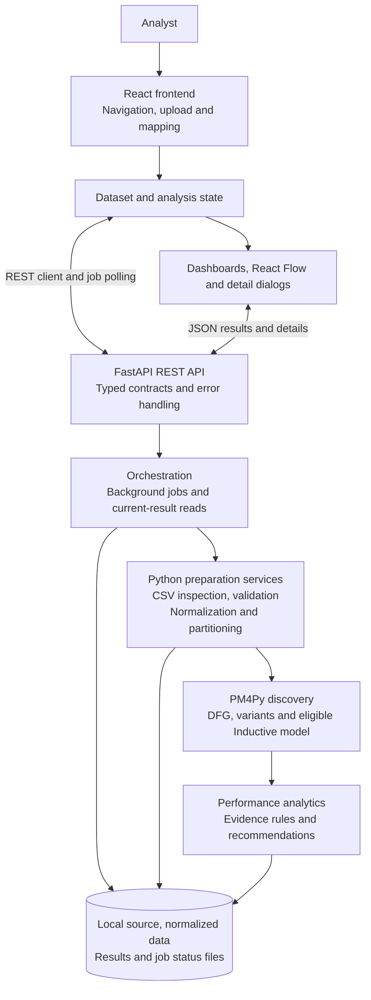

# 3 System Architecture

## 3.1 Architectural approach

The application is a local, modular full-stack system. A React single-page application presents the upload workflow and analysis results. A FastAPI service owns validation, normalization, process mining, performance calculation, findings and recommendations. The browser does not discover process models. The backend uses Pandas for tabular processing and PM4Py for discovery, then serializes results into Pydantic-validated JSON contracts.

The implementation is a modular monolith rather than independently deployed microservices. Service classes compose a shared dataset store and pass results through explicit stages. This arrangement provides separation of responsibilities without requiring a message broker, relational database or external analytics service.

## 3.2 Architecture diagram

The arrows show responsibility and data movement, not separate deployment units. API reads pass through service methods that verify the current dataset revision; the diagram abbreviates those calls. The editable diagram source is [architecture.mmd](diagrams/architecture.mmd).

## 3.3 Frontend components

| Component | Implemented responsibility |
|---|---|
| Application shell and routing | Persistent navigation, original GIU logo, upload action, responsive workspace and the five primary analysis sections; Cases is a supporting route. Analysis pages are loaded through React lazy imports. |
| Dataset provider | Holds the deliberately selected ready dataset in React memory. A fresh session has no automatically selected fixture or previous upload. |
| Analysis provider | Resolves an explicit `dataset` URL parameter, follows the latest job or starts analysis for an explicitly selected ready dataset, polls status, loads matching discovery and analytics snapshots, and rejects mismatched analysis identifiers. |
| Upload feature | File selection and drag-and-drop, bounded preview, editable mappings, timestamp options, optional case-state interpretation, validation review and explicit processing confirmation. |
| Visual analysis features | React Flow renders observed process paths and graphs; Recharts presents calculated comparisons. Modal dialogs expose evidence, variants, case timelines and recommendation plans. |
| API client | Centralized base URL, JSON handling, abort signals, timeout handling and structured `ApiError` values. Dataset and analysis clients use a 120-second request timeout; the shared default is 10 seconds. |

Navigation preserves deliberate dataset and process selections. No source CSV is embedded in frontend code. Selecting a path in Process Explorer changes the displayed path; process summary metrics and entity measurements remain process-wide and are labeled accordingly. The frontend is a presentation and interaction layer, not a second mining implementation.

## 3.4 Backend responsibilities

| Module directory under `backend/app/services/` | Responsibility |
|---|---|
| `ingestion` | Strict CSV inspection, limits, source storage, hashing and atomic JSON file writes. |
| `mapping` | Canonical-field definitions and suggestions based on column names; the user retains control. |
| `validation` and `normalization` | Validation issues with severity and resolution, timezone handling, source preservation and deterministic ordering. |
| `process_separation` | Grouping by explicitly mapped process type, including arbitrary process names. |
| `discovery` and `variants` | Ordered PM4Py traces, actual DFG discovery, optional process tree and Petri net, exact activity sequences and clean JSON serialization. |
| `analytics` | Case, activity, transition, resource and department measurements with coverage information. |
| `bottlenecks` | Configurable, evidence-linked screening rules and threshold comparisons. |
| `recommendations` | Deterministic review actions selected from actual finding categories. |
| `orchestration` | Dataset revisions, result caching, analysis jobs, current-result reads, recommendation preparation and case pagination. |

FastAPI constructs and connects these services in the application factory. PM4Py is imported lazily for discovery; application startup and health requests do not load a fixture or run mining.

## 3.5 API boundary and failure handling

The frontend normally calls `/api/v1`. During development Vite proxies `/api` to `http://127.0.0.1:8000`; `VITE_API_BASE_URL` and `API_PROXY_TARGET` support explicit configuration. FastAPI exposes interactive documentation at `/api/docs` and its schema at `/api/openapi.json`.

Backend errors are normalized and carry a code, user-facing message and request identifier. CORS permits configured explicit origins. These mechanisms support local development and troubleshooting; they do not provide authentication, authorization or tenant isolation. Detailed contracts are documented in [API Documentation](07-api-documentation.md).

## 3.6 Persistence and revision consistency

Each accepted upload receives a UUID directory under the configured dataset-storage root, which defaults to `backend/runtime/datasets`. Files include `source.csv`, `metadata.json`, `validation.json`, `normalized.jsonl`, `result.json`, `discovery.json`, `analytics.json`, `recommendations.json`, `job-latest.json` and individual `job-<id>.json` records as stages become available.

Source and normalized-file SHA-256 values, validation identifiers, discovery identifiers and analytics identifiers bind results to their inputs. Current-result reads reject changed files or stale revisions rather than presenting unrelated snapshots as current. JSON writes use a temporary file, flush and atomic replacement. A per-dataset reentrant lock coordinates mutations within the server process. Case indexes use a bounded in-memory cache of two analysis entries; persisted normalized files remain authoritative.

Persistence therefore already exists. However, the system stores current analysis snapshots rather than a full queryable history of all result versions. There is no implemented user account, dataset ownership model, dataset catalogue interface, public deletion endpoint or durable distributed job queue. Closing the selected dataset in the browser clears selection; it does not delete stored files.

## 3.7 Background execution and deployment limits

The job service uses one `ThreadPoolExecutor` worker and permits up to eight active or queued dataset identifiers. A repeated start request for an already active dataset returns that job. A shared semaphore bounds discovery and analytics execution. Job stages are persisted at actual work boundaries; the UI displays those stages rather than fabricated completion percentages.

The active-job registry and locks are process-local. A queued or running job whose server process has restarted is marked failed as interrupted when read; users must rerun it. The implementation is suitable for the documented single-process local deployment. Multiple worker processes, automatic job resumption, large-scale throughput and concurrent institutional use require additional engineering and validation.

## 3.8 Implementation traceability

- [Application factory](../backend/app/main.py), [configuration](../backend/app/core/config.py) and [API router](../backend/app/api/router.py).
- [Dataset orchestration](../backend/app/services/orchestration/datasets.py), [jobs](../backend/app/services/orchestration/jobs.py), [discovery orchestration](../backend/app/services/orchestration/discovery.py), [analytics orchestration](../backend/app/services/orchestration/analytics.py) and [workspace service](../backend/app/services/orchestration/workspace.py).
- [Storage](../backend/app/services/ingestion/storage.py), [frontend entry point](../frontend/src/main.tsx), [routes](../frontend/src/app/App.tsx), [dataset context](../frontend/src/features/datasets/DatasetContext.tsx), [analysis context](../frontend/src/features/analysis/AnalysisContext.tsx), [API client](../frontend/src/lib/api/client.ts) and [Vite configuration](../frontend/vite.config.ts).

