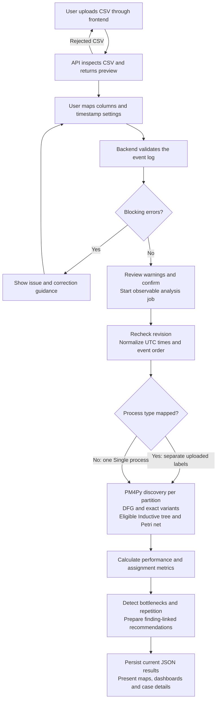

# 4 End to End System Pipeline

The principal workflow is Upload → Preview → Map Columns → Validate → Confirm → Process → Explore. Each stage uses the uploaded data. Synthetic fixtures are supplied manually for development tests and are never an automatic application input.

## 4.1 Pipeline diagram

The diagram follows the successful orchestration path and the principal validation branches. Inductive discovery failure is recorded explicitly while available DFG and variant results remain usable; other unhandled pipeline failures mark the job failed. If a process field is absent, the validator inserts `Single process` before the partitioning stage. The decision is shown at partitioning to make its effect clear. Editable source: [pipeline.mmd](diagrams/pipeline.mmd).

## 4.2 Upload and CSV ingestion

The frontend obtains configured upload limits and checks the selected file before submitting multipart form data. The backend independently checks the extension, actual byte count, nonempty content, permitted encoding, headers, rectangular rows, control characters, row count and column count. A failed upload is discarded. Accepted CSV data is stored separately from application code with a source hash and dataset identifier.

Default limits are 50 MiB, 250,000 rows and 200 columns. These are configured safeguards, not demonstrated performance capacity. UTF-8, UTF-8 with a byte-order mark and BOM-marked UTF-16 are supported. The reader recognizes comma, semicolon, tab or pipe separators. Data is subsequently loaded as strings so identifiers and original text are not silently coerced.

## 4.3 Preview and column mapping

Inspection returns filename, size, total rows and columns, encoding, delimiter, column names, missing counts and percentages, unique counts, inferred type hints and at most 20 sample rows. Type hints use up to 500 nonempty samples per column; they are not a guarantee of a column's semantic type. Missing and unique counts come from the inspection pass over the file.

Mapping suggestions are editable. Case ID, activity and timestamp are required. Optional lifecycle intervals, process type, identifiers, assignments, status, outcome, cost and explicit ordering support richer analysis. The user can set an IANA timezone, an explicit timestamp format and day-first interpretation. Unmapped source columns are retained in each normalized record's attributes.

## 4.4 Validation and revision creation

Backend validation checks mapping existence and reuse, required values, mapped process labels, timestamp parsing, daylight-saving ambiguity, interval relationships, duplicate records, source ordering, event-order values, cost conversion and conflicting event identifiers. It distinguishes blocking errors, warnings and informational observations. Missing optional columns are informational; missing values within mapped optional columns produce warnings.

Validation returns issue codes, descriptions, corrective guidance, counts and bounded examples, together with a new validation identifier. If no blocking errors exist, it also returns a ten-record normalized preview. This preview is prepared in memory; the authoritative normalized log is persisted during processing after confirmation.

The user can revise mappings and validate again. Confirmation must reference the current validation identifier, and warnings must be acknowledged before processing. Exact duplicate events are retained after acknowledgement, so their effect on frequency and repetition remains transparent.

## 4.5 Job creation and actual progress

The confirmed request starts a job with states `queued`, `running`, `completed` or `failed`. The backend records eight stages:

| Stage key | Work represented |
|---|---|
| `reading_dataset` | Verify and read the stored source CSV. |
| `validating_event_log` | Reapply the confirmed mapping and validation rules. |
| `normalizing_data` | Construct and order the canonical records. |
| `separating_processes` | Summarize independent process partitions. |
| `discovering_process_models` | Discover DFG, variants and any eligible Inductive model. |
| `calculating_performance_metrics` | Aggregate timing, repetition and assignment measurements. |
| `detecting_bottlenecks` | Evaluate the configured evidence rules. |
| `preparing_recommendations` | Generate and persist review actions from findings. |

The frontend polls job state approximately every 600 milliseconds while a job remains queued or running. Stage timestamps describe actual execution boundaries. They are not estimates of remaining time. Source-hash and revision checks prevent a changed file or old mapping from silently entering the job.

## 4.6 Normalization and ordering

Naive timestamps are interpreted in the selected timezone; timestamps with offsets retain their specified instant. All canonical times become UTC. Ambiguous and nonexistent local times require correction rather than silent guessing. Source information is retained in `attributes`, with `source_row` identifying the original one-based data record.

Events are sorted by process type, case ID, timestamp, supplied event order for ties and source row. The supplied order is preserved as `source_event_order`; a contiguous canonical `event_order` is regenerated within each case. Timestamp order takes precedence if the source ordering conflicts. A collision-safe key combines process and case identity, preventing equal case IDs in different process partitions from being merged.

## 4.7 Process separation and discovery

An explicitly mapped process-type column determines independent partitions. Without it, all records belong to `Single process`. The system does not infer a department as a process boundary or require a fixed list of HR workflows. Each partition becomes ordered PM4Py traces.

DFG discovery always measures actual immediate succession and observed starts and ends. Exact variants group cases by their complete observed activity sequence. Depending on the discovery options and eligibility limits, Inductive Miner additionally produces a process tree that is converted to a Petri net. Unknown and incomplete case-state semantics are reported explicitly. Chapter 6 defines these methods and their limitations.

## 4.8 Metrics, findings and recommendations

The analytics engine uses the normalized records and discovered identifiers to calculate case spans, processing intervals, measured interval gaps, separately labeled timestamp-gap approximations, repeated activities, variants, assignments and handovers. Missing information remains unavailable or is expressed through coverage; it is not replaced by a plausible KPI.

The bottleneck engine applies process-specific statistical comparisons and configurable business thresholds. Every finding identifies its entity, measurement, comparison, affected cases and source evidence. Recommendations map those findings to review actions and a measurement plan. They neither establish causes nor estimate guaranteed improvement.

## 4.9 Persistence and presentation

Results are stored as JSON linked to the normalized-file hash, validation revision and related analysis identifiers. The frontend retrieves current results and bounded detail pages. Overview provides summary comparisons, Process Explorer shows observed paths, Bottlenecks exposes evidence, Paths explains variant differences, Recommendations presents investigation plans and Cases displays event timelines.

These stages establish a complete technical analysis workflow. Results from the supplied synthetic fixture demonstrate the workflow on simulated HR events, not the actual performance of a university.

## 4.10 Implementation traceability

- [Upload interface](../frontend/src/features/datasets/UploadPage.tsx), [CSV reader](../backend/app/services/ingestion/csv_reader.py), [mapping](../backend/app/services/mapping/mapper.py) and [validation](../backend/app/services/validation/engine.py).
- [Normalization](../backend/app/services/normalization/normalizer.py), [dataset processing](../backend/app/services/orchestration/datasets.py), [partitioning](../backend/app/services/process_separation/separator.py) and [job orchestration](../backend/app/services/orchestration/jobs.py).
- [Discovery](../backend/app/services/discovery/engine.py), [analytics](../backend/app/services/analytics/engine.py), [findings](../backend/app/services/bottlenecks/engine.py) and [recommendations](../backend/app/services/recommendations/engine.py).

