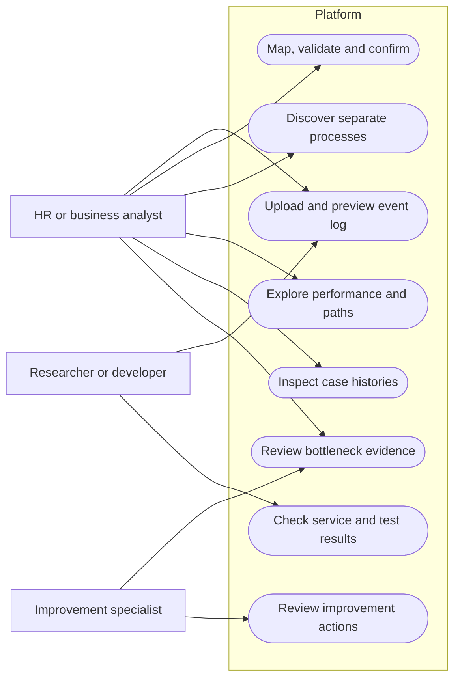

# 8 Use Cases and User Workflow

## Actors and interactions

HR analysts, business analysts and improvement specialists share the current application capabilities. A researcher or developer maintains the local environment and examines test evidence. These actors express responsibilities rather than enforced access permissions. There is no login, tenant separation or administrator interface.

This Mermaid flowchart represents use-case relationships; it is not an authorization model or formal UML diagram. The editable source is [use-cases.mmd](diagrams/use-cases.mmd).

## UC-01 Upload an event log

**Actor:** analyst. **Precondition:** frontend and backend are available. The analyst chooses Upload, drops a CSV or browses for one, and receives the filename, dimensions, inferred column information, missing-value counts and a bounded sample. The frontend and backend enforce supported type and size rules. An upload failure is displayed with a useful message. **Outcome:** a stored dataset and preview exist, without automatically starting mining or changing an already active analysis.

## UC-02 Map, validate and prepare

**Actor:** analyst. **Precondition:** successful upload. The analyst reviews suggestions for Case ID, Activity and Timestamp, maps optional fields, and specifies timezone/date parsing where necessary. If no process-type field is explicitly mapped, the log is treated as one process. Optional case-outcome interpretation is configured explicitly from a source attribute and its values; a completed event must not be confused with a completed case.

The analyst requests validation, corrects blocking errors or mappings, reviews warnings and acknowledges them before confirmation. Missing optional fields do not by themselves block the log. **Outcome:** a confirmed validation revision can be processed. A changed or stale revision must be validated again. Finalized wizard steps are read-only; a fresh upload permits a new mapping revision without disrupting the active result.

## UC-03 Discover HR processes

**Actor:** analyst. **Precondition:** a valid confirmed dataset. Confirmation starts the backend analysis job. The frontend presents actual queued, running, completed or failed states and the recorded stage statuses, without fabricated percentages. The backend normalizes events, separates processes, performs discovery and variants, computes analytics and findings, and generates review recommendations. **Outcome:** completed results become active. Failure is reported and can be retried; a failed replacement does not silently overwrite the user's previous selected dataset.

## UC-04 Explore process performance

**Actor:** analyst. The Overview shows actual totals, observed-duration comparisons and selected findings. Process Explorer provides a process selector, four concise summary measures, a process diagram, ranked paths and transition timing summaries. The initial diagram shows the most common observed activity sequence. Users can select another path or switch to all recorded paths.

Frequency, Time and Rework modes change the measures shown on nodes and edges. Users can pan, zoom, fit the map, inspect steps and transitions, and use map settings. The visual task boxes and boundary markers are BPMN-inspired; they are not a discovered BPMN specification. Selecting a path changes the diagram, while the surrounding summary and timing measures retain their labelled whole-process scope. **Outcome:** the user can connect an observed route to its actual frequencies and timing evidence without assuming that displayed branches prove business decision semantics.

## UC-05 Analyze bottlenecks

**Actor:** analyst or improvement specialist. The user opens Bottleneck Analysis, chooses a process and optionally filters severity, category or activity/transition. Each row identifies the measured issue, its comparison value and affected case count. A focused dialog presents evidence, thresholds and interpretation limits. **Outcome:** a supported observation is identified for investigation. Long elapsed time does not, by itself, establish avoidable delay, a cause or a responsible person.

## UC-06 Compare process variants

**Actor:** analyst. Process paths groups cases that follow exactly the same ordered activity labels. The user compares ranked frequencies, case shares and observed durations, opens the full sequence, and navigates to its matching cases. Repeated labels remain part of the sequence. **Outcome:** the user can distinguish common and uncommon routes and examine cases that explain a comparison. Different durations across paths do not prove that the path alone causes the difference.

## UC-07 Inspect an individual case

**Actor:** analyst. The user searches case identifiers or filters by process and path, selects a case, and opens its timeline in a modal dialog. Available timestamps, activities, resources, departments, outcomes and preserved attributes can be inspected. Events are paginated for longer cases. **Outcome:** the user can trace an aggregate observation back to recorded events. The dialog displays observed history only; pending or unrecorded events are not added to complete a diagram.

## UC-08 Review improvement recommendations

**Actor:** improvement specialist. The user filters recommendations by process and opens a review plan. The plan links to the originating finding, evidence, suggested investigation/action and measurement approach. **Outcome:** an evidence-linked proposal for human review. The application neither executes HR changes nor supplies invented savings or proven causal explanations.

## UC-09 Reopen or replace an analysis

**Actor:** analyst. A saved explicit dataset URL reselects an existing prepared dataset. Upload another dataset starts a new wizard; the active result changes after successful processing. Closing the current selection clears frontend state, not stored files. **Outcome:** controlled selection and replacement. There is no general dataset catalogue, deletion endpoint or account-based sharing workflow.

## Interface and accessibility evidence

The current interface uses a persistent desktop navigation sidebar, a responsive mobile navigation drawer, compact summary rows and detail dialogs rather than permanent inspection cards. Dialogs expose accessible names, keyboard focus handling and Escape dismissal. These implemented affordances and recorded interaction checks do not constitute a complete accessibility certification.

Source references: [routes](../frontend/src/app/App.tsx), [upload workflow](../frontend/src/features/datasets/UploadPage.tsx), [analysis context](../frontend/src/features/analysis/AnalysisContext.tsx), [Process Explorer](../frontend/src/features/process-explorer/ProcessExplorerPage.tsx), [case explorer](../frontend/src/features/cases/CaseExplorerPage.tsx), [shared dialog](../frontend/src/components/DetailDialog.tsx).

